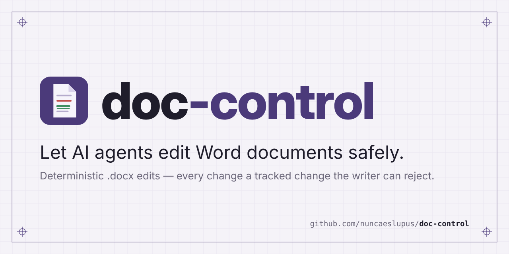

# doc-control

<p align="center">
  
</p>

> Status: **file engine working** (pre-1.0; the API may still change). The live Word
> engine is not built yet. See `status/specification.md` and `status/plan.md`.

A deterministic tool that lets AI agents work on Word documents quickly,
precisely and safely, ideally live in the Word window the writer has open.
Every content change is a tracked change the writer can accept or reject.

For anyone — writers and editors first — who wants an AI agent's help inside a
Word document without a single silent change.

## Usage

Install with `pip install doc-control` (or run it without installing: `uvx doc-control`).
Python 3.11+, no other dependencies. To drive the Word that is open on Windows, install
`doc-control[live]` (it adds pywin32); LibreOffice needs no extra package.

Command line, JSON in and JSON out:

```bash
doc-control outline --json '{"doc": "Novela.docx"}'
doc-control find --json '{"doc": "Novela.docx", "query": "lluvia"}'
doc-control batch --json '{"doc": "Novela.docx", "ops": [
  {"op": "text.replace", "at": "p12#a7b2a7b2:4-10", "text": "nieve"},
  {"op": "comment.add", "at": "p40#c0ffee00", "text": "¿Seguro?"}]}'
doc-control help batch          # the JSON Schema of any operation
```

Every write is a tracked change by `DOC_CONTROL_AUTHOR` (default `Claude`), made after a
backup and verified, with `undo` and `history.*` to go back. Addresses like
`p12#a7b2a7b2` come from read results and fail loudly if the paragraph changed.

From Python, a document can be held open for many reads, with whole results:

```python
from doc_control import api

with api.open("Novela.docx") as doc:
    for p in doc.paragraphs(normalized=True, pages=True):
        print(p["at"], p["style_name"], p["page"], p["text"][:40])
    chapters = doc.run("segment", {"unit": "chapters"})["chapters"]
```

Recipes propose batches of fixes (Spanish typography, quotes, dashes, spacing, empty
paragraphs and more): `recipe.list`, then `recipe.run` returns a batch to review and apply.

References: [operations](docs/operations.md) · [errors](docs/errors.md).

## Planned shape

- **One core, two engines, one API**
  - *File engine*: edits a closed `.docx` with the Python standard library only,
    rewriting only the parts it touches. Read operations also take a `.txt`, `.md` or
    `.odt` file (hard-wrapped text detected; Markdown `#` headings and OpenDocument
    headings become Heading styles); writes refuse it.
  - *Live engine*: controls the open Word (Windows/COM first, Mac later).
- **Two front doors**: a CLI with JSON in/out, and an MCP server
  (`doc-control mcp`, stdio) for Claude Desktop / Cowork and other MCP clients.
- **Safety first**: lock-file and on-disk change detection, backup before every
  write, verification, automatic restore, operation log with undo, and
  `unintended_changes == 0` as a gate.
- **No AI inside.** Judgment belongs to the agent; approval belongs to the writer.

It will replace `docx-fixer`, whose rules become packs built on this tool, and
serve `literary-critic` as its first downstream consumer.

## MCP server

`doc-control mcp` serves every operation as an MCP tool over stdio, one tool per
operation (`para.move` becomes `para_move`), with the same JSON Schemas and the
same response envelope as the CLI. It needs nothing beyond the package itself:

```json
{
  "mcpServers": {
    "doc-control": { "command": "uvx", "args": ["doc-control", "mcp"] }
  }
}
```

## Documents

- [Operation reference](docs/operations.md) and [error reference](docs/errors.md), generated from the code
- [Initial research: tooling and risks](docs/research/01-tooling-and-risks.md)

## Development

This repo uses [claude-arsenal](https://github.com/nuncaeslupus/claude-arsenal)
(spec-driven workflow, gated tasks in `arsenal/tasks/`). See `CLAUDE.md`.

## Related projects

Same author:

- [claude-arsenal](https://github.com/nuncaeslupus/claude-arsenal) — a Claude Code skill and plugin marketplace: specs before code, failing tests first, gates with numbers.
- [literary-critic](https://github.com/nuncaeslupus/literary-critic) — lets an LLM index, analyse and advise on a full novel manuscript the way a professional editor would; doc-control's first planned consumer.
- [drawspec](https://github.com/nuncaeslupus/drawspec) — declarative diagram spec → clean, themeable SVG; JSON with no coordinates, so an LLM can write it.
- [integral-job-search](https://github.com/nuncaeslupus/integral-job-search) — a candidate-centred job search run as a conversation in Claude Code.

## License

[Apache-2.0](LICENSE)
